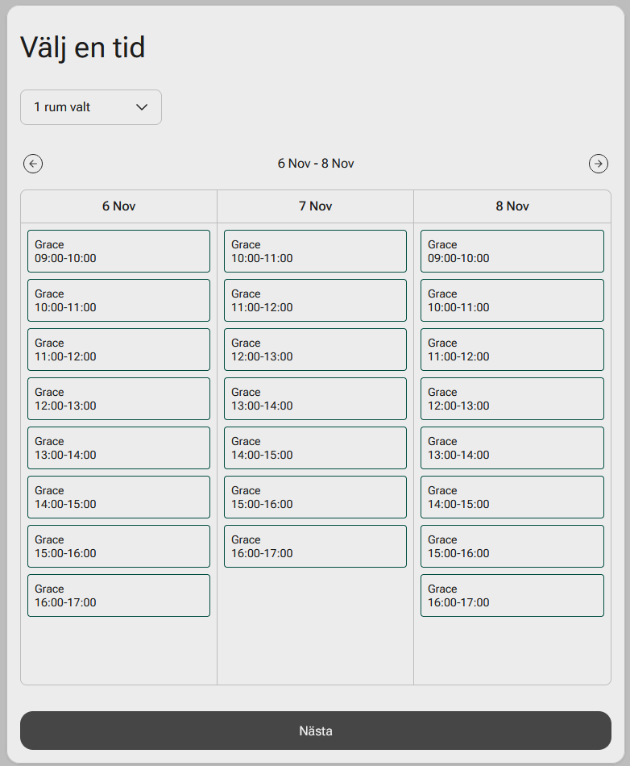
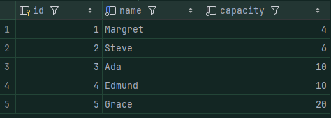
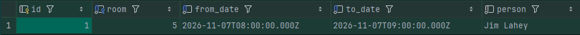

# Room booking service
This is a small next.js application for booking rooms. It uses a sqlite database to store bookings.

The design is primarily made for mobile, but is lightly responsive for desktop.

## When is a room available?

A room is always available between 09:00 - 17:00 with 1 hour intervals. And, if no one has booked the room yet,

You also need to enter your fullname.

## On booking completion

When a room has been booked, it will be stored in the database. The reserved time for that room will not be available for booking.

The form will reset itself with the new list. The booking is ofcourse stored in the database file called `room_booking_db.db`.

## Database

The database have two tables:
1. Room: A room contains an id as the primary key, name and capacity. Rooms do not have a relation with bookings.

2. Booking: A booking contains an id, a room id, from_date, to_date and the person who booked it.

The file is called `room_booking_db.db` and is located in the root. If no file exists, one will be created.

You can seed the database by running the `sql` file `seed_booking_db.sql`, also located in the root folder.

## Scripts

- `npm run dev` - start the development server
- `npm run build` - build the application for production
- `npm run start` - start the production server
- `npm run test` - run tests